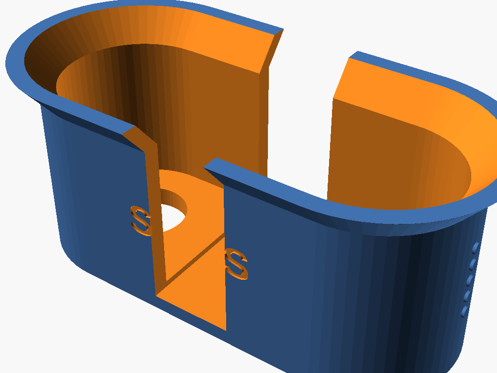
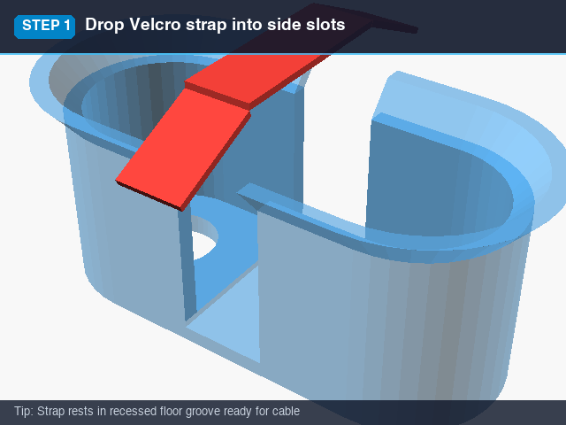

# Handheld Cable Coiling & Strapping Jig

A parametric, 3D-printable handheld jig designed to compress loose or coiled cables into uniform, compact oblong (or circular) bundles and secure them with standard 1/2" (12–15 mm) hook-and-loop (Velcro One-Wrap) ties.

Ideal for storing uniform cables inside random boxes, cookie tins, drawer organizers, and modular containers.

---

## 3D Previews

| Small Oblong (USB-C & Mobile) | Medium Oblong (Laptop & HDMI) |
| :---: | :---: |
|  |  |
| **Large Oblong (Power & Appliance)** | **Small Circular (Round Donut Coils)** |
|  |  |

---

## Features

- **Oblong / Stadium Compression**: Flattens circular hand coils into space-saving flat bundles with parallel sides.
- **Flared Funnel Lead-In**: 6 mm chamfered mouth smoothly guides and compresses cables as you press them inside.
- **Integrated Stopper**: Positive bottom floor sets a consistent bundle depth every time.
- **Recessed Strap Channel & Drop-in Slots**: Transverse slots through both walls and a recessed groove in the floor allow the Velcro strap to be pre-positioned flat so the cable rests directly on it.
- **Dual Finger Ejection Ports**: Bottom holes under both end lobes let you push the finished strapped bundle straight out with your thumbs.
- **Handheld Ergonomics**: Compact footprint with ribbed tactile grips on the ends. Fits comfortably in one hand and stores easily in a drawer.
- **100% Support-Free Printing**: Sits upright on its flat bottom base. Requires no supports or brim.

---

## Standard Presets

| Size | Inner Dimensions (L × W × D) | Target Cables | Ready-to-Print File |
| :--- | :--- | :--- | :--- |
| **Small (S)** | 80 × 30 × 30 mm | USB-C, Lightning, Micro-USB, earbuds (1–2 m) | [`cable_jig_small.stl`](cable_jig_small.stl) |
| **Medium (M)** | 115 × 42 × 45 mm | Laptop power bricks, HDMI cables, audio leads | [`cable_jig_medium.stl`](cable_jig_medium.stl) |
| **Large (L)** | 155 × 55 × 55 mm | Heavy appliance cords, thick AC extension leads | [`cable_jig_large.stl`](cable_jig_large.stl) |
| **Small Circular** | 30 mm dia × 30 mm | Round donut coils (traditional circular coiling) | [`cable_jig_circular_small.stl`](cable_jig_circular_small.stl) |

---

## 3D Printing Recommendations

| Parameter | Recommended Setting | Note |
| :--- | :--- | :--- |
| **Print Orientation** | Upright on base | Flat bottom sits directly on build plate |
| **Supports** | **None (0%)** | All overhangs (slots and top flare) are self-supporting |
| **Material** | PLA, PETG, or ABS/ASA | PLA is plenty rigid and fast; PETG for extra drop toughness |
| **Layer Height** | 0.20 mm or 0.28 mm | 0.28 mm Draft prints fast with clean overhangs |
| **Wall Perimeters** | 3 to 4 walls | Ensures 100% solid walls without infill weakness |
| **Infill** | 15% – 20% (Gyroid or Grid) | Bottom floor and walls will be nearly solid |
| **Brim** | None needed | Generous flat base area adheres easily |

---

## How to Use

1. **Pre-position the Strap**: Drop a 1/2" (12–15 mm) Velcro One-Wrap cable tie through the open top slots into the floor groove. Leave both ends hanging outside the sides.
2. **Coil Cable**: Wind your cable loosely around 2–3 fingers or in your hand into a rough circle.
3. **Press into Jig**: Push the coil down through the flared mouth into the oblong sleeve. The funnel sides squeeze the circular coil into an oblong shape until it seats against the bottom stopper.
4. **Cinch the Tie**: Fold the strap ends over the top waist of the bundle and cinch tightly.
5. **Eject**: Push upward through the bottom finger ports with your thumbs. The neat, uniform bundle pops out cleanly!

---

## Parametric Customization (OpenSCAD)

To generate a custom size for specific containers:

1. Open [`cable_jig.scad`](cable_jig.scad) in [OpenSCAD](https://openscad.org/).
2. In the **Customizer** panel (or top of the script):
   - Set `preset = "CUSTOM";`
   - Adjust `custom_inner_length`, `custom_inner_width`, and `custom_inner_depth`.
   - Optionally toggle `shape_type = "circular";` for round coils.
3. Press **F5** to preview, **F6** to render, and **F7** to export your new STL.
4. Or run `python3 generate_stls.py` to rebuild all STLs and previews.
