# Handheld Cable Coiling & Strapping Jigs

Parametric, 3D-printable handheld jigs designed to turn loose cables into uniform, space-saving bundles secured with standard 1/2" (12–15 mm) hook-and-loop (Velcro One-Wrap) ties — ideal for neat storage in boxes, cookie tins, and containers.

This repository includes **two complementary designs** that also **mate together as 2-in-1 capsules** (available in both **Oblong** and **Circular**):
1. **Design 1 — Internal Compression Sleeve (`cable_jig.scad`)**: Coil loosely in your hand, press down into the sleeve to smush round coils into flat oblong bundles (or donut coils), cinch, and eject from the bottom.
2. **Design 2 — External Wrap-Around Mandrel (`cable_mandrel_jig.scad`)**: Wind cables directly around the **outside** of a tapered mandrel (twin-post oblong or flanged hollow tube) against a bottom stopper flange, cinch, and slide off.

---

## Which Files Do I Print? (Quick-Start Pairings)

For the **2-in-1 Mating Capsule** experience, print **one matching pair** for each cable size you want to organize:

### Oblong 2-in-1 Pairs *(Recommended for boxes & tins — packs cables flat)*
| Size | Best For | Outer Sleeve (Print 1) | Inner Mandrel (Print 1) |
| :--- | :--- | :--- | :--- |
| **Small (S)** | USB-C, Lightning, earbuds | [`cable_jig_small.stl`](cable_jig_small.stl) | [`cable_mandrel_oblong_small.stl`](cable_mandrel_oblong_small.stl) |
| **Medium (M)** | Laptop chargers, HDMI, audio | [`cable_jig_medium.stl`](cable_jig_medium.stl) | [`cable_mandrel_oblong_medium.stl`](cable_mandrel_oblong_medium.stl) |
| **Large (L)** | Heavy AC cords, extension leads | [`cable_jig_large.stl`](cable_jig_large.stl) | [`cable_mandrel_oblong_large.stl`](cable_mandrel_oblong_large.stl) |

### Circular 2-in-1 Pairs *(Classic round donut coils)*
| Size | Best For | Outer Sleeve (Print 1) | Inner Flanged Tube (Print 1) |
| :--- | :--- | :--- | :--- |
| **Small (S)** | USB-C, Lightning, earbuds | [`cable_jig_circular_small.stl`](cable_jig_circular_small.stl) | [`cable_mandrel_tube_small.stl`](cable_mandrel_tube_small.stl) |
| **Medium (M)** | Laptop chargers, HDMI, audio | [`cable_jig_circular_medium.stl`](cable_jig_circular_medium.stl) | [`cable_mandrel_tube_medium.stl`](cable_mandrel_tube_medium.stl) |
| **Large (L)** | Heavy AC cords, extension leads | [`cable_jig_circular_large.stl`](cable_jig_circular_large.stl) | [`cable_mandrel_tube_large.stl`](cable_mandrel_tube_large.stl) |

> **Tip:** Not sure where to start? Print the **Small Oblong pair** (`cable_jig_small.stl` + `cable_mandrel_oblong_small.stl`) in **PETG** or **PLA+** — it covers 90% of everyday USB/charging cables and snaps together into one compact capsule.

---

## Design 1: Internal Compression Sleeve (`cable_jig.scad`)

### How to Use

1. **Pre-position the Strap**: Drop a 1/2" (12–15 mm) Velcro One-Wrap cable tie through the open top slots into the floor groove. Leave both ends hanging outside the sides.
2. **Coil Cable**: Wind your cable loosely around 2–3 fingers or in your hand into a rough circle.
3. **Press into Jig**: Push the coil down through the flared mouth into the oblong sleeve. The funnel sides squeeze the circular coil into an oblong shape until it seats against the bottom stopper.
4. **Cinch the Tie**: Fold the strap ends over the top waist of the bundle and cinch tightly.
5. **Eject**: Push upward through the bottom finger ports with your thumbs. The neat, uniform bundle pops out cleanly!

### 3D Previews & STLs

| Small Oblong (USB-C & Mobile) | Medium Oblong (Laptop & HDMI) | Large Oblong (Power & Appliance) |
| :---: | :---: | :---: |
|  | 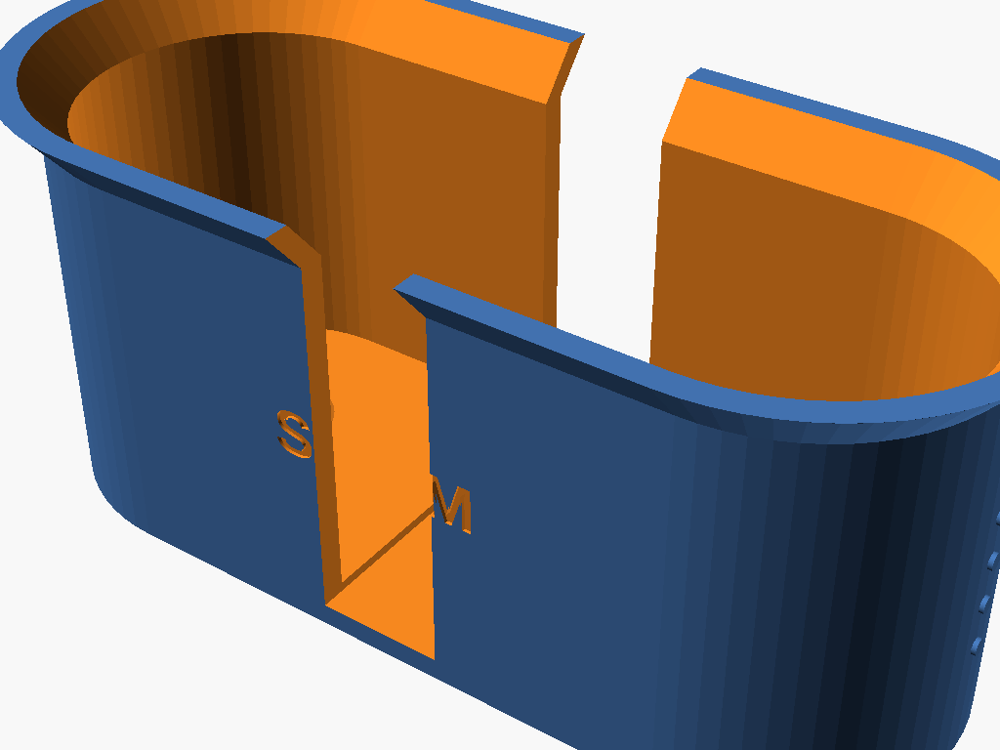 | 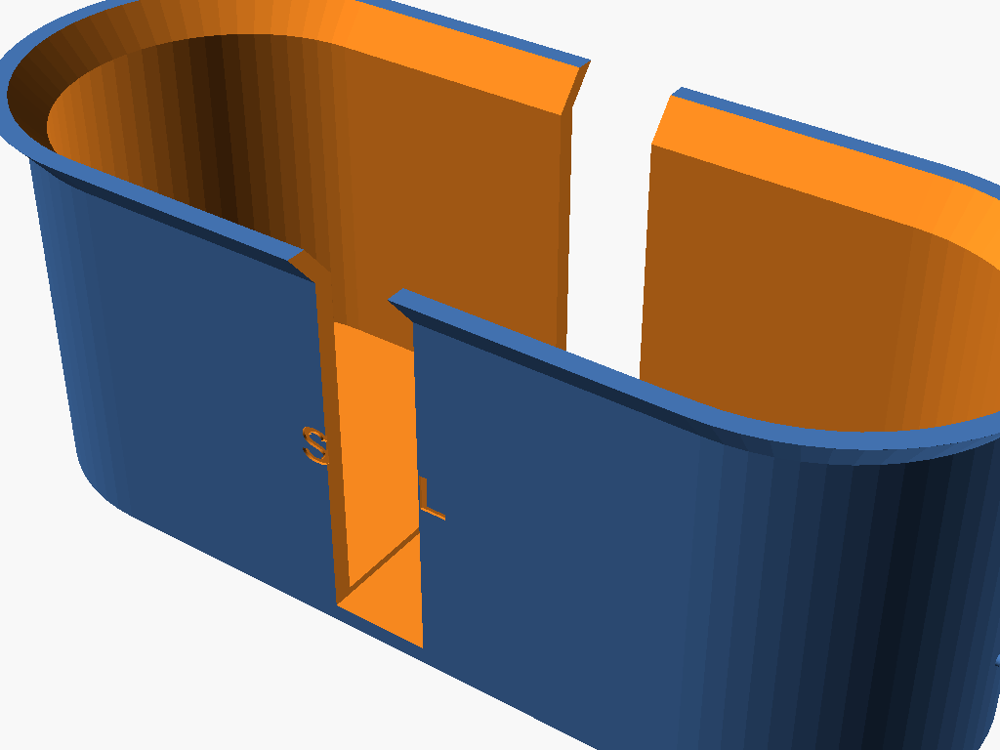 |
| **Small Circular (Donut)** | **Medium Circular (Donut)** | **Large Circular (Donut)** |
| 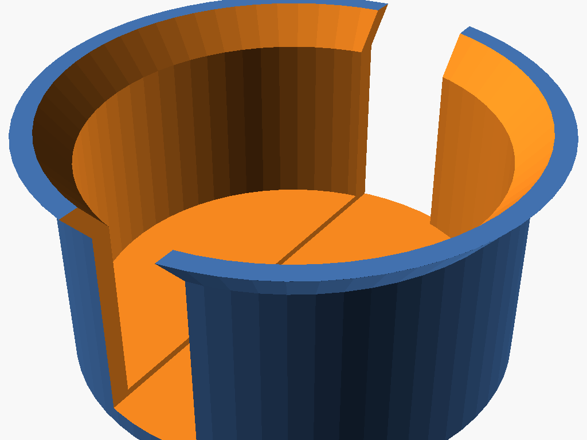 |  |  |

| Size | Inner Dimensions (L × W × D) | Target Cables | Ready-to-Print File |
| :--- | :--- | :--- | :--- |
| **Small Oblong (S)** | 80 × 30 × 30 mm | USB-C, Lightning, Micro-USB, earbuds (1–2 m) | [`cable_jig_small.stl`](cable_jig_small.stl) |
| **Medium Oblong (M)** | 115 × 42 × 45 mm | Laptop power bricks, HDMI cables, audio leads | [`cable_jig_medium.stl`](cable_jig_medium.stl) |
| **Large Oblong (L)** | 155 × 55 × 55 mm | Heavy appliance cords, thick AC extension leads | [`cable_jig_large.stl`](cable_jig_large.stl) |
| **Small Circular (S)** | Ø 66 × 30 mm | Round donut coils (pairs with Ø 50 mm tube) | [`cable_jig_circular_small.stl`](cable_jig_circular_small.stl) |
| **Medium Circular (M)** | Ø 92 × 45 mm | Round donut coils (pairs with Ø 72 mm tube) | [`cable_jig_circular_medium.stl`](cable_jig_circular_medium.stl) |
| **Large Circular (L)** | Ø 122 × 55 mm | Round donut coils (pairs with Ø 98 mm tube) | [`cable_jig_circular_large.stl`](cable_jig_circular_large.stl) |

---

## Design 2: External Wrap-Around Mandrel (`cable_mandrel_jig.scad`)

### How to Use

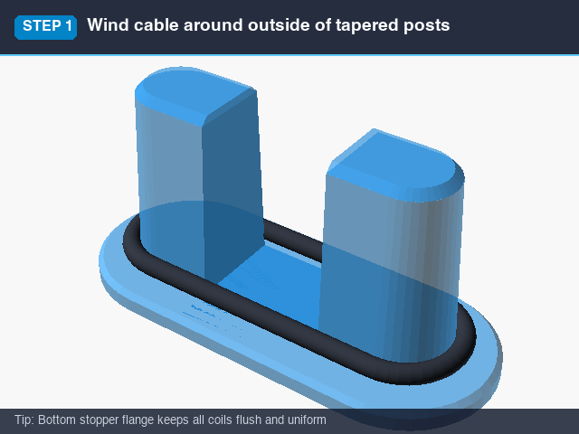

1. **Wind Around Outside**: Tuck the cable tail into the flange notch if helpful, then wind the cable neatly around the outside of the tapered posts against the bottom stopper flange.
2. **Pass Strap Through Center Gap**: Thread a 1/2" Velcro tie through the open 24 mm center window between the posts (or through the opposite slots in the flanged tube).
3. **Wrap & Cinch**: Pull the tie snugly around the bundle waist to lock both sides together.
4. **Slide Off**: Lift the uniform bundle straight up off the tapered mandrel — the gentle draft taper lets it glide off effortlessly.

### 3D Previews & STLs

| Oblong Mandrel — Small | Oblong Mandrel — Medium | Oblong Mandrel — Large |
| :---: | :---: | :---: |
| 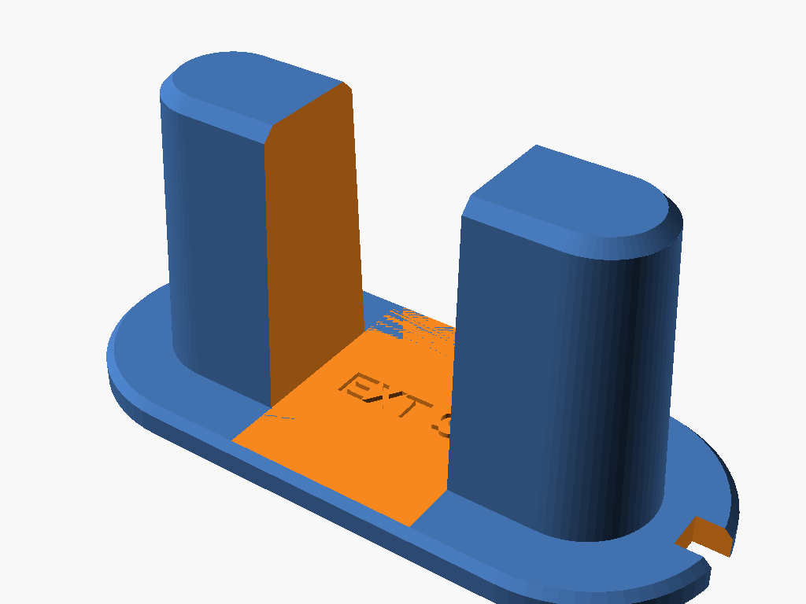 | 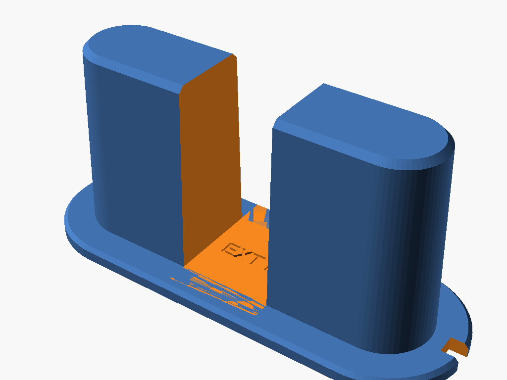 | 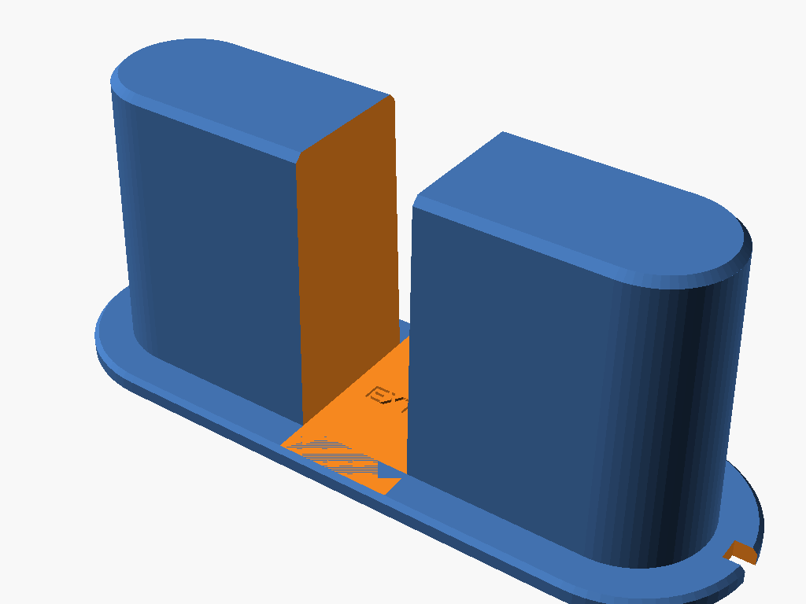 |
| **Flanged Tube — Small** | **Flanged Tube — Medium** | **Flanged Tube — Large** |
| 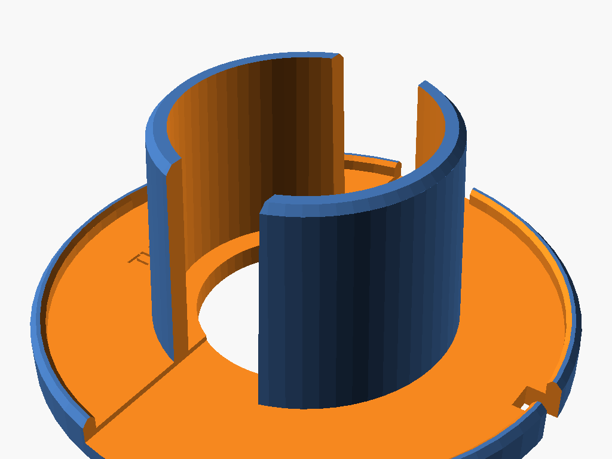 | 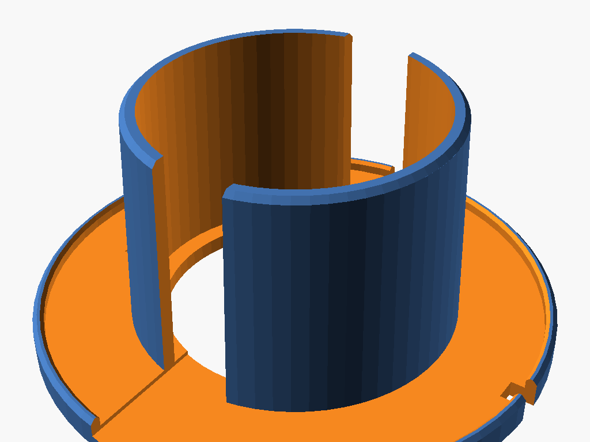 | 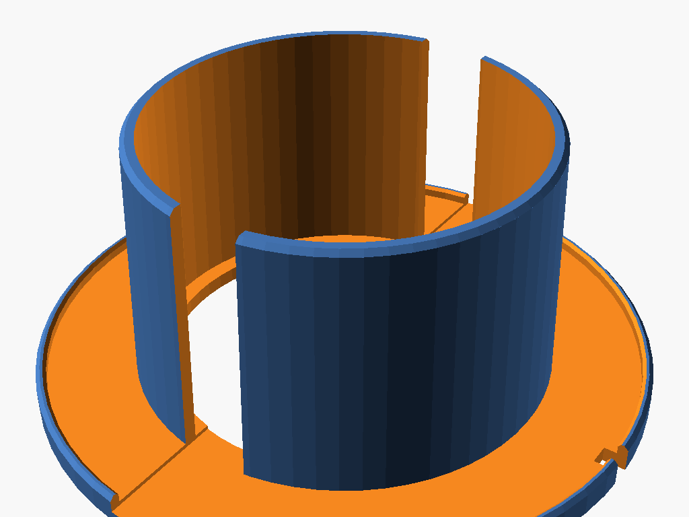 |

| Variant & Size | Mandrel Dimensions | Target Cables | Ready-to-Print File |
| :--- | :--- | :--- | :--- |
| **Oblong Mandrel (S)** | 64 × 18 × 34 mm | USB-C, Lightning, earbuds | [`cable_mandrel_oblong_small.stl`](cable_mandrel_oblong_small.stl) |
| **Oblong Mandrel (M)** | 95 × 24 × 49 mm | Laptop chargers, HDMI, audio leads | [`cable_mandrel_oblong_medium.stl`](cable_mandrel_oblong_medium.stl) |
| **Oblong Mandrel (L)** | 130 × 32 × 59 mm | Heavy appliance & extension cords | [`cable_mandrel_oblong_large.stl`](cable_mandrel_oblong_large.stl) |
| **Flanged Tube (S)** | Ø 50 × 34 mm | Round coils (pairs with Ø 66 mm circular sleeve) | [`cable_mandrel_tube_small.stl`](cable_mandrel_tube_small.stl) |
| **Flanged Tube (M)** | Ø 72 × 49 mm | Round coils (pairs with Ø 92 mm circular sleeve) | [`cable_mandrel_tube_medium.stl`](cable_mandrel_tube_medium.stl) |
| **Flanged Tube (L)** | Ø 98 × 59 mm | Round coils (pairs with Ø 122 mm circular sleeve) | [`cable_mandrel_tube_large.stl`](cable_mandrel_tube_large.stl) |

---

## 2-in-1 Mating Capsule Mode (Sleeve + Mandrel / Tube)

Both the **Oblong Mandrels (`S`, `M`, `L`)** and **Circular Flanged Tubes (`S`, `M`, `L`)** include a raised registration pocket (`0.35 mm` slip-fit tolerance per side, `0.8 mm` lead-in chamfer) with coaxially aligned `16 mm` strap slots and a `1.0 mm` floor strap groove so the matching **Internal Compression Sleeve** nests inverted right on top of it:

- **During use**: Wind on the mandrel/tube, press the inverted sleeve down to compress the outer loops cleanly, and cinch the Velcro strap through the aligned center slots.
- **For storage**: Nest the empty halves together into one compact capsule in your drawer.

| Oblong 2-in-1 Mating Capsule | Circular 2-in-1 Mating Capsule |
| :---: | :---: |
| 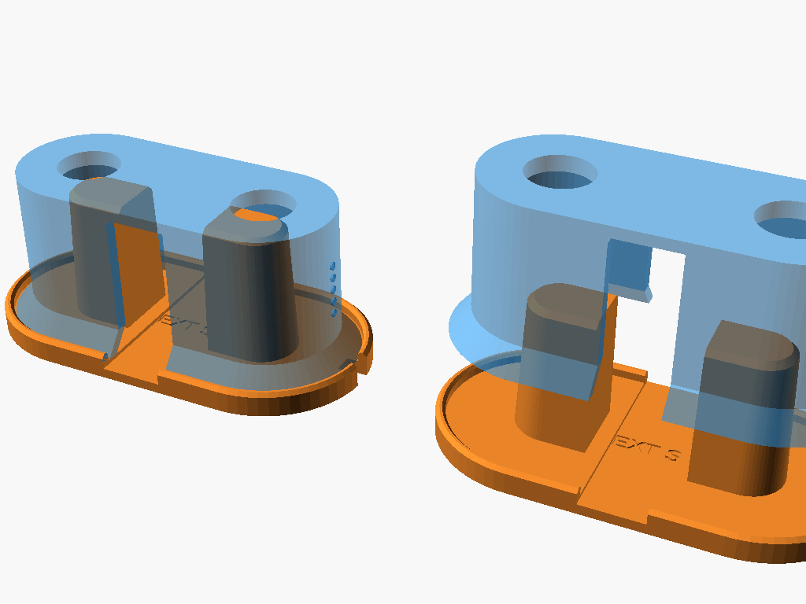 | 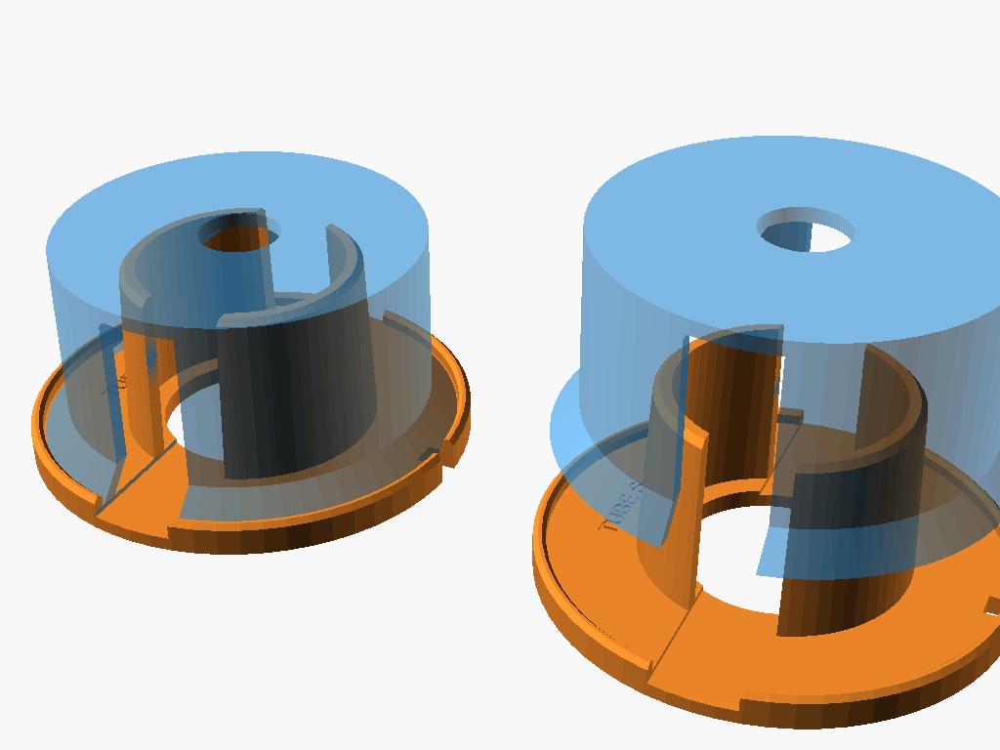 |

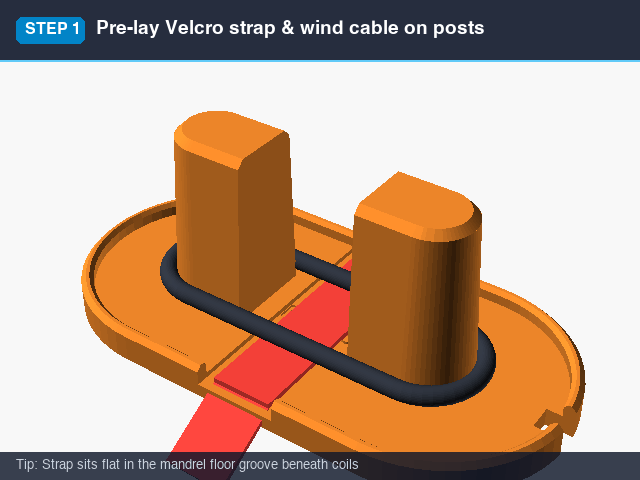

---

## 3D Printing Recommendations

| Parameter | Recommended Setting | Note |
| :--- | :--- | :--- |
| **Print Orientation** | Upright on base | Flat bottom sits directly on build plate |
| **Supports** | **None (0%)** | All overhangs (flares, chamfers, slots) are self-supporting |
| **Material** | PLA, PETG, or ABS/ASA | PLA is rigid and fast; PETG for extra drop toughness |
| **Layer Height** | 0.20 mm or 0.28 mm | 0.28 mm Draft prints fast with clean overhangs |
| **Wall Perimeters** | 3 to 4 walls | Ensures strong walls and rigid posts |
| **Infill** | 15% – 20% (Gyroid or Grid) | Plenty for both designs |
| **Brim** | None needed | Generous flat base area adheres easily |

---

## Parametric Customization (OpenSCAD)

To generate a custom size for specific containers:

1. Open [`cable_jig.scad`](cable_jig.scad) or [`cable_mandrel_jig.scad`](cable_mandrel_jig.scad) in [OpenSCAD](https://openscad.org/).
2. In the **Customizer** panel (or top of the script):
   - Set `preset = "CUSTOM";`
   - Adjust the custom length, width, and height/depth variables.
   - Toggle `shape_type` between `"oblong"` and `"circular"`.
3. Press **F5** to preview, **F6** to render, and **F7** to export your new STL.
4. Or run `python3 generate_stls.py` to rebuild all STLs and previews.
